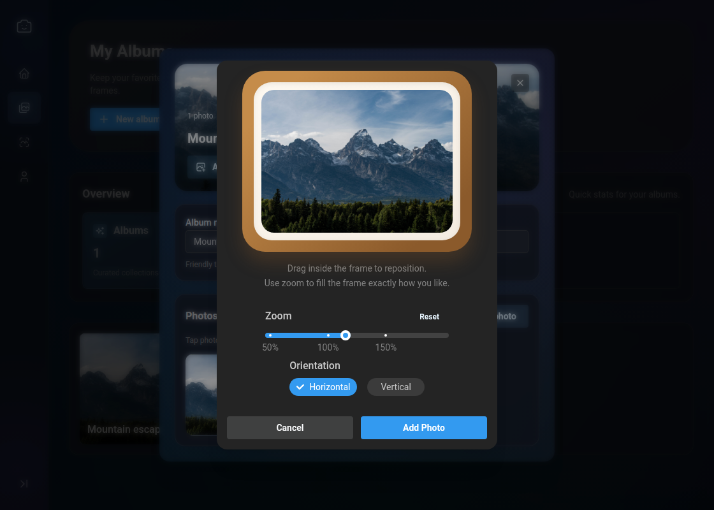
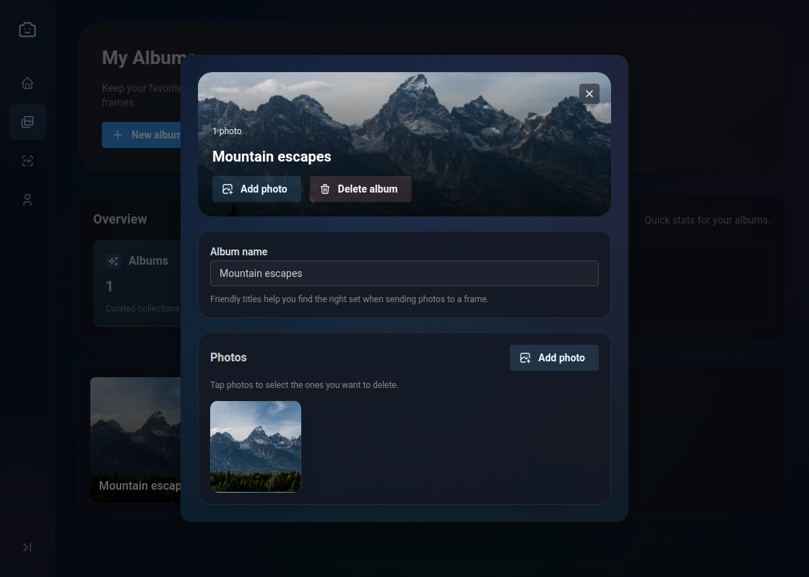
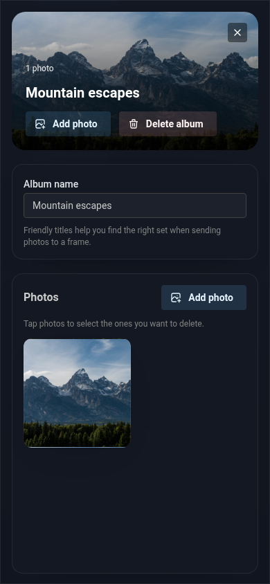

# Picie

**Your favorite photos, beyond your phone.**

Picie brings your photo albums to a connected e-paper frame. Compose a photo in the browser, choose an album, and set a schedule—the app and frame handle delivery together.



### Compose it. Collect it. Display it.

- **Make each photo fit.** Preview the frame, adjust the crop and zoom, and choose an orientation before uploading.
- **Keep your favorites together.** Create albums and manage photos from a desktop or phone.
- **Choose the rhythm.** Assign an album to a paired frame and update it at intervals or at specific times in its timezone.

<details>
<summary><strong>Explore the album experience on desktop and mobile</strong></summary>

Keep a collection ready for your frame, with photo previews and upload controls in one place.





</details>

*Live app screenshots with demo data. The frame shown is the editor preview.*

Sample photo: *Grand Tetons in Grand Teton National Park*, USGS. [Public-domain image via USGS](https://www.usgs.gov/media/images/grand-tetons-grand-teton-national-park).

## Built across the full stack

Picie connects a React interface, a Node.js backend, and ESP8266 firmware. The work spans image processing, device pairing, access control, scheduling, and a custom transfer protocol for the frame's 600 × 448 display.

## How it works

1. The browser sends account, album, photo, and scheduling requests to the HTTP API.
2. The backend stores metadata in PostgreSQL and encrypted photo files on disk. Sharp normalizes images, then dithering converts them to the display's palette.
3. The frame authenticates over a persistent device connection and requests image chunks.
4. The backend advances the displayed-photo state and schedule after the frame acknowledges the transfer.

| Component | Stack | Source |
| --- | --- | --- |
| Web interface | React, TypeScript, Mantine, Vite | [`frontend/`](frontend/) |
| API and device server | Node.js, Express, Sequelize, PostgreSQL, Sharp | [`backend/`](backend/) |
| Frame firmware | C++, Arduino, ESP8266, PlatformIO | [`device/`](device/) |
| Deployment | Docker, PostgreSQL, Caddy, GitHub Actions | [`deploy/`](deploy/) |

The HTTP API and the frame's binary TCP protocol are separate interfaces. Firmware uses a TLS connection to the device endpoint; the backend TCP listener sits behind the TLS termination layer.

Explore the [architecture diagram](docs/architecture.md) and [image delivery sequence](docs/device-protocol.md#image-delivery) for a closer look.

## Engineering decisions

**Delivery is confirmed, not assumed.** Sending bytes does not immediately mark a photo as displayed. Transfers retain pending state, and authorization is checked again when queued work executes and during delivery.

**Photo storage can recover from failures.** File operations and database changes are coordinated through a recovery journal so failed uploads or deletions can be cleaned up.

**Schedules have explicit timezones.** Frames can use interval schedules or local times, with defined handling of daylight-saving transitions.

**Tests exercise the whole journey.** End-to-end tests run the real browser app and backend against disposable PostgreSQL and a TCP frame simulator. They compare received image data and database state, including failed uploads, expired pairing sessions, and interrupted transfers.

## Documentation

- [Architecture](docs/architecture.md) — system diagram, photo lifecycle, and code locations.
- [Device protocol](docs/device-protocol.md) — image delivery sequence, authentication, binary messages, pixel format, pairing, and current limitations.
- [Backend setup and administration](backend/README.md)
- [Deployment](deploy/README.md)

## Run locally

You can explore accounts, albums, and photo editing without a physical frame. Pairing and delivery require a provisioned frame; the end-to-end suite provides an automated simulated journey.

Prerequisites: Node.js 20 with npm, and PostgreSQL. The optional database command below uses Docker. Run the commands from the repository root unless noted otherwise.

### 1. Install dependencies

```sh
npm ci --prefix backend
npm ci --prefix frontend
```

### 2. Start a development database

Use an existing PostgreSQL instance with a dedicated database and user, or start a local container:

```sh
docker run --name picie-dev-db \
  -e POSTGRES_USER=picie \
  -e POSTGRES_PASSWORD=picie-local-only \
  -e POSTGRES_DB=picie \
  -p 127.0.0.1:5432:5432 \
  -d postgres:16
```

The password above is for this local development database only. On subsequent runs, use `docker start picie-dev-db`.

### 3. Configure the backend

Create `backend/.env`:

```dotenv
NODE_ENV=development
PORT=7734
POSTGRES_HOST=127.0.0.1
POSTGRES_NAME=picie
POSTGRES_USER=picie
POSTGRES_PASSWORD=picie-local-only
JWT_SECRET=replace-with-a-generated-secret
PHOTO_ENC_KEY=replace-with-a-generated-base64-key
```

Run this command twice and use a separate result for each of `JWT_SECRET` and `PHOTO_ENC_KEY`:

```sh
node -e "console.log(require('crypto').randomBytes(32).toString('base64'))"
```

`PHOTO_ENC_KEY` must decode to 32 bytes. Keep it stable while using existing photos: replacing it makes those files unreadable. Photo storage defaults to `backend/photos/`; `PHOTO_STORAGE_PATH` can override it. Local `.env` files are ignored by Git.

### 4. Start the app

In one terminal:

```sh
npm run dev --prefix backend
```

The backend initializes its database tables on startup. In another terminal:

```sh
VITE_API_URL=http://localhost:7734 npm run dev --prefix frontend -- --host localhost
```

Open the localhost URL printed by Vite and register an account. New accounts are regular users; see [administrator provisioning](backend/README.md#provisioning-an-administrator) if you need device administration.

## Tests

From the repository root:

```sh
npm test --prefix backend -- --runInBand
npm test --prefix frontend
npm run test:e2e --prefix frontend
npm run build --prefix frontend
```

Browser tests need Chromium installed with `npx playwright install --with-deps chromium` from `frontend/`. End-to-end tests additionally need PostgreSQL 16 binaries on `PATH` or their directory set in `E2E_PG_BIN`; they create their own database and storage without using your development `.env`.

- [End-to-end setup and recovery tests](frontend/e2e/README.md)
- [Backend tests](backend/tests/README.md)
- [Browser tests](frontend/tests/README.md)
- [Docker image and runtime checks](tests/README.md)

With PlatformIO installed, run firmware checks with:

```sh
pio test -d device -e native
pio run -d device -e esp12e
```

GitHub Actions runs backend, browser, end-to-end, firmware, and Docker checks. Browser and end-to-end failures retain reports and traces for debugging.

## Hardware and deployment

The firmware targets an ESP8266 (`esp12e`) and a 600 × 448 e-paper display. Hardware setup also requires device identity provisioning, Wi-Fi setup, and a trusted CA certificate for the configured server. Building the firmware alone does not configure a working frame.

The server endpoint is configured in [`app_config.cpp`](device/src/app/app_config.cpp). The [CA generation script](device/generate_root_ca.py) accepts `ROOT_CA_CERT_FILE` or `ROOT_CA_CERT`; device identity provisioning is handled by the [serial helper](device/tools/provision_serial.py).

[Production deployment notes](deploy/README.md) describe the current hosting setup. Local development above does not require access to that server.

## Current status

Picie is an evolving personal project. Automated tests cover browser, backend, and simulated device behavior; they do not prove that a physical display refreshed or that a firmware installation succeeded on hardware.

Firmware installation confirmation and the reboot command remain open work. Recent device security and delivery changes also need hardware verification. See the [issue tracker](https://github.com/runevh/picie/issues) for current progress.
