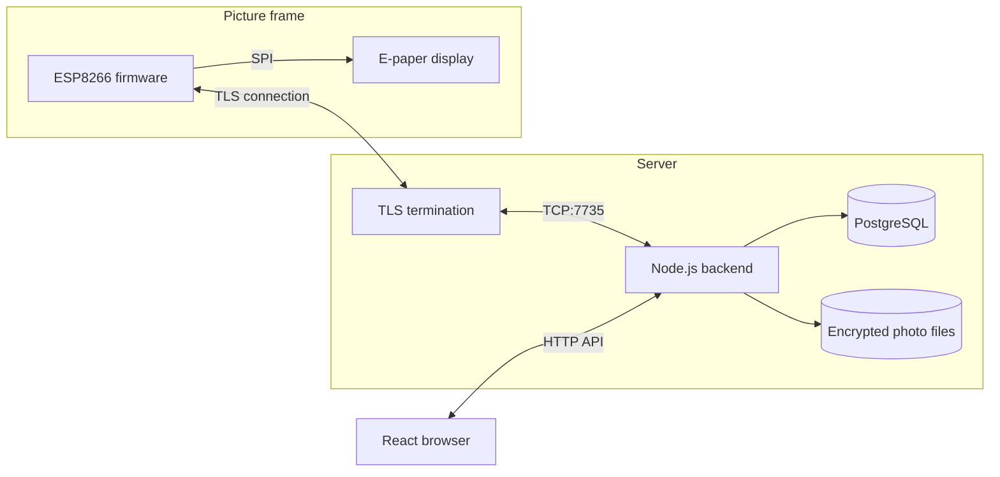

# Architecture

Picie has three application components: a browser interface, a backend, and ESP8266 firmware. PostgreSQL stores metadata; the filesystem stores encrypted photo assets.

The backend owns account permissions, image conversion, schedules, and delivery state. The frame authenticates to it, requests data in chunks, and drives the display. See the [device protocol](device-protocol.md) for exact bytes and acknowledgement rules.

## From upload to display

1. The browser lets the user crop, zoom, and orient a photo before upload.
2. The backend verifies album access, normalizes the image with Sharp, and dithers it into the display palette. It produces a preview and packed display bytes.
3. Photo files are encrypted with AES-256-GCM. PostgreSQL records the photo and album metadata. A database journal coordinates file publication and deletion so interrupted operations can be recovered.
4. A frame's state identifies its assigned album, current photo, planned next photo, and schedule. The scheduler checks connected frames for due work.
5. Delivery runs through the connection's task queue. Album and photo access are checked again as the work executes, including during transfer.
6. The backend waits for the frame's completion status before confirming the current photo and advancing the schedule.

The saved next photo and the confirmed current photo are separate so an interrupted transfer does not silently advance the album.

## Identity and ownership

A device's UUID and secret authenticate its connection. A public device code lets a user find it for pairing; it is not an authentication secret. Pairing requires a temporary PIN displayed on the frame and assigns ownership to the signed-in user.

Browser authentication and device authentication are separate. A connected device does not automatically have access to an arbitrary user's photos: delivery also checks its album assignment and ownership relationships.

## Where to find things

| Area | Location |
| --- | --- |
| Browser views and photo editor | [`frontend/src/components/`](../frontend/src/components/) |
| HTTP routes and access middleware | [`backend/src/routes/`](../backend/src/routes/), [`backend/src/middleware/`](../backend/src/middleware/) |
| Request handlers | [`backend/src/controller/`](../backend/src/controller/) |
| Database models | [`backend/src/models/`](../backend/src/models/) |
| Photo conversion, storage, and transfer | [`backend/src/services/photo/`](../backend/src/services/photo/) |
| Pairing and device delivery | [`backend/src/services/device/`](../backend/src/services/device/) |
| Connection framing and task queue | [`backend/src/services/tcp.js`](../backend/src/services/tcp.js) |
| Scheduling | [`backend/src/schedules/`](../backend/src/schedules/) |
| Firmware lifecycle | [`device/src/app/`](../device/src/app/) |
| Firmware transport and display | [`device/src/network/`](../device/src/network/), [`device/src/display/`](../device/src/display/) |

## Operational boundaries

Connected sockets, task queues, pairing sessions, and pairing limits live in backend memory. The current design assumes a single backend instance managing those connections. Multiple replicas would need coordination for sessions, rate limits, scheduling, and device routing.

Photo metadata and files must remain consistent, and the photo encryption key must remain available to read existing files. The recovery journal addresses interrupted file operations; it is not a replacement for backups.

Automated tests cover backend behavior, browser flows, and a real backend/database journey with a simulated frame. They cannot prove physical display behavior. Firmware installation confirmation and a dedicated reboot command remain incomplete; see the [protocol limitations](device-protocol.md#firmware-delivery-and-current-limits).

For setup, start with the [main README](../README.md#run-locally). For hosting, see [deployment notes](../deploy/README.md).
