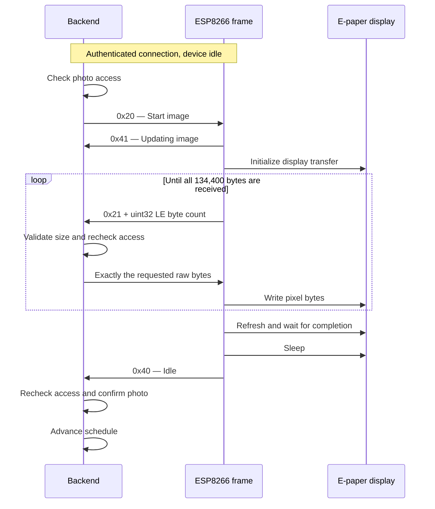

# Device protocol

Picie uses a persistent connection between the ESP8266 frame and the backend. The browser uses the HTTP API; it never sends these binary messages directly.

This documents the current implementation, including its limitations. There is no protocol version negotiation, transfer ID, or resume offset on the wire.

## Connection and authentication

The frame verifies the server's TLS certificate before sending credentials. The backend listens for plain TCP on port `7735`, behind the deployment's TLS termination layer. Keep that internal listener separate from the public TLS endpoint. See [deployment notes](../deploy/README.md).

After TLS connects, the device sends one ASCII line:

```text
<36-character UUID><62-character hexadecimal secret>\r\n
```

There is no separator between the UUID and secret. The backend accepts LF or CRLF, validates the format, and compares the secret with its stored bcrypt hash. It replies with the single byte `10` (hex) on success. Invalid authentication closes the connection without an error frame.

The device must wait for `10` before sending binary messages. The backend allows 15 seconds for authentication; the current firmware waits up to 2 seconds for the reply after sending credentials. A newly authenticated connection replaces any previous connection for the same UUID.

Identity provisioning and account pairing are separate operations: provisioning installs the UUID and secret on the device; pairing assigns an authenticated device to a user.

## Binary messages

All codes below are hexadecimal. All multi-byte integers are unsigned, 32-bit, little-endian. Lengths include the opcode byte.

| Code | Direction | Length | Meaning |
| --- | --- | --- | --- |
| `01` | Server → device | 1 | Heartbeat ping |
| `02` | Device → server | 1 | Heartbeat pong |
| `10` | Server → device | 1 | Authentication accepted |
| `20` | Server → device | 1 | Start image transfer |
| `21` | Device → server | 5 | Request image bytes: opcode + byte count |
| `30` | Server → device | 5 | Start firmware transfer: opcode + total byte count |
| `31` | Device → server | 5 | Request firmware bytes: opcode + byte count |
| `40` | Device → server | 1 | Idle |
| `41` | Device → server | 1 | Updating image |
| `42` | Device → server | 1 | Pairing status; defined, but not emitted by the current pairing flow |
| `43` | Device → server | 1 | Updating firmware (`updating_frame` in backend state) |
| `44` | Device → server | 1 | Rebooting; recognized by backend, not emitted by current firmware |
| `4F` | Device → server | 1 | Error |

TCP is a byte stream: a read may contain part of a message or several messages. The backend buffers incomplete messages and dispatches complete ones in order. Unknown device opcodes close the connection.

Chunk responses from the server are **raw bytes**, with no opcode or length prefix. Their length comes from the device's preceding request. Bytes inside a chunk must not be interpreted as commands. Transfers must be serialized; do not insert commands into the payload stream.

For example, `21 00 04 00 00` requests 1,024 image bytes. The server then sends exactly those bytes.

## Image delivery



The sequence shows successful scheduled delivery. Failures abort the flow without confirming the photo or advancing its schedule.

The image has a fixed size, so `20` has no size field. The device requests chunks until it has received all 134,400 bytes. Its chunk size is the smaller of the remaining payload and 75% of available heap.

The backend requires `41` before the first chunk request. Requests must be nonzero and cannot exceed the remaining payload. Completion requires `40` after the update began and all bytes were sent. An unexpected status, timeout, disconnect, or authorization failure rejects the transfer and closes the connection.

Only after confirmation does scheduled delivery update the current photo and advance the schedule. Access to the assigned album and photo is checked before and during delivery and again after confirmation. A failed transfer does not count as a confirmed display update.

This is a firmware acknowledgement, not independent proof of the physical image. There is no per-chunk checksum, image identifier, or partial-transfer resume mechanism.

### Pixel format

The display is 600 × 448 pixels. Pixels are packed in row-major order, two palette indices per byte: the first pixel occupies the high nibble, the second the low nibble. For example, `01` encodes a black pixel followed by white.

| Index | Display constant | Backend palette RGB |
| --- | --- | --- |
| `0` | Black | `#03162b` |
| `1` | White | `#F2E9D8` |
| `2` | Green | `#2E9455` |
| `3` | Blue | `#2B528C` |
| `4` | Red | `#B34040` |
| `5` | Yellow | `#9AA432` |
| `6` | Orange | `#D95C32` |
| `7` | Clean | `#EDD4A6` |

The backend uses these palette values for dithering; they are not a guarantee of the panel's rendered colors. The payload is packed display data, not PNG or JPEG. Encryption of stored photo files is removed before transmission; TLS protects the device connection.

## Pairing

Pairing uses the same image-transfer flow to display a four-digit PIN. It has no separate TCP command.

1. A signed-in user starts pairing with the frame's six-digit public code. The frame must be online, idle, and unowned.
2. The backend creates a session, renders its PIN, and sends the resulting display bytes.
3. After image confirmation, the session becomes ready. The browser receives the session ID and expiry, not the PIN.
4. The user enters the PIN shown on the physical frame. The backend checks the session and grants ownership in a database transaction.

Sessions expire five minutes after creation. One active session is allowed per user and per device. Limits allow five starts and three incorrect guesses per 15-minute window, tracked for both user and device. Sessions and limits are held in memory; restarting the backend clears them. Cancelling or expiring a session does not erase the displayed PIN, but it makes that session unusable.

See [pairing sessions](../backend/src/services/device/pairingSessions.js) and the [pairing controller](../backend/src/controller/deviceController.js).

## Firmware delivery and current limits

The server sends `30` followed by the binary's total length. The device reports `43`, reads the length, prepares the updater, and requests chunks with `31`. The server responds with raw firmware bytes. The device calls `Update.end(true)`, reports `40`, and restarts. Failures in the firmware handler report `4F`.

Unlike image delivery, the backend sender currently returns after sending bytes; it does not wait for installation confirmation or verify the version after reconnect. It also ends its loop on a zero-length request and caps oversized requests to the remaining data. A successful sender result therefore does **not** prove a complete or successful installation.

The current reboot endpoint sends a bare `30`, which the firmware treats as a firmware-transfer header and waits for a size. There is no working dedicated reboot command. Do not use that endpoint as a protocol example for rebooting.

## Timeouts and work queue

| Operation | Current behavior |
| --- | --- |
| Heartbeat | Ping after 5 minutes; wait 10 seconds for pong; retry after 5 seconds; close after 3 consecutive misses |
| Wait for idle | Backend timeout of 60 seconds; backend also treats error status as ready for queued work |
| Queued task | Default deadline of 120 seconds from enqueue; closes connection on expiry |
| Image chunk request | Backend default 20 seconds; scheduled image delivery uses 30 seconds |
| Image completion | Backend deadline of 90 seconds from transfer creation |
| Image bytes | Firmware timeout after 10 seconds without another byte |
| Firmware header | Firmware waits up to 5 seconds for the size |
| Firmware chunk | Backend request timeout and firmware availability timeout are each 20 seconds |

Each connection runs one task at a time and retains at most one pending task. New pending work supersedes older pending work. Disconnecting rejects waiting responses and tasks. Firmware handlers process transfers synchronously, so normal command handling is paused during a transfer.

## Source and verification

- [Backend framing, authentication, heartbeat, and queue](../backend/src/services/tcp.js)
- [Image sender](../backend/src/services/photo/imageSender.js) and [confirmation state](../backend/src/services/photo/transfer.js)
- [Image conversion](../backend/src/services/photo/dithering.js)
- [Firmware sender](../backend/src/services/device/firmwareSender.js)
- [Device networking](../device/src/network/network.cpp), [image handler](../device/src/display/display_updater.cpp), and [firmware handler](../device/src/network/firmware_update.cpp)
- [Backend test guide](../backend/tests/README.md) and [real-app tests with a simulated frame](../frontend/e2e/README.md)

Framing, authentication, queue behavior, pairing, and image confirmation have backend regression tests. Simulated-device tests verify software behavior; physical display refresh and firmware installation still require hardware testing.
